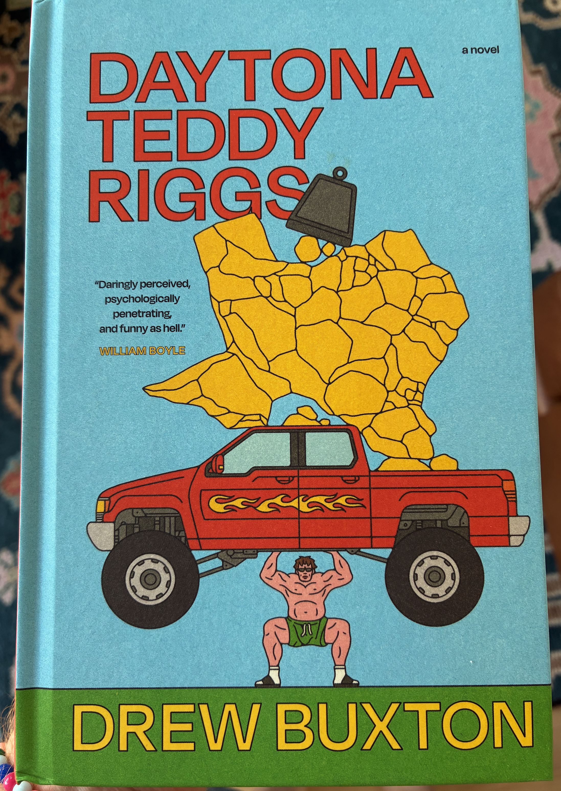
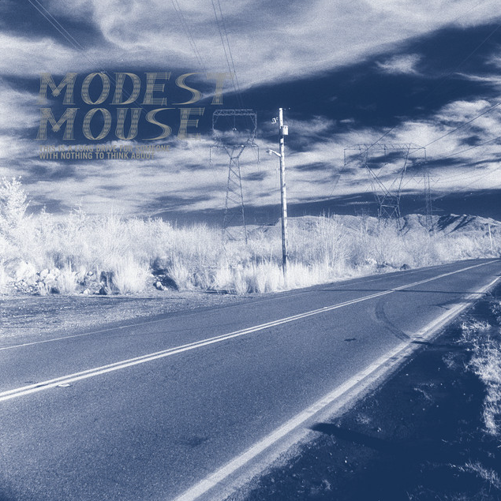

  <!-- Book section -->
  

    <h1>On the nightstand</h1>
    
    

      My good friend's debut novel full of Teddy exercising poor judgement.
    

  

  <!-- Music section -->
  

    <h1>On rotation</h1>
    
    

      Iconic opening riff.
    

  

  <!-- Boid section -->
  

    <h1>BOID OF THE MONTH</h1>
    
    

      This boid's goin' through it
    

  






