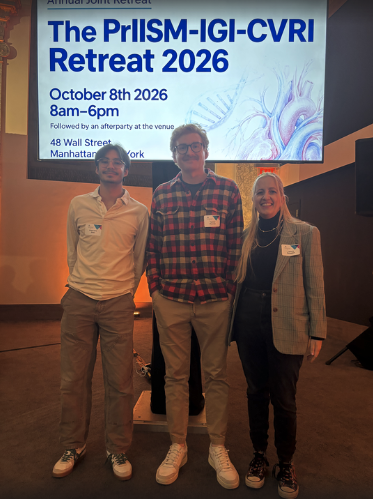
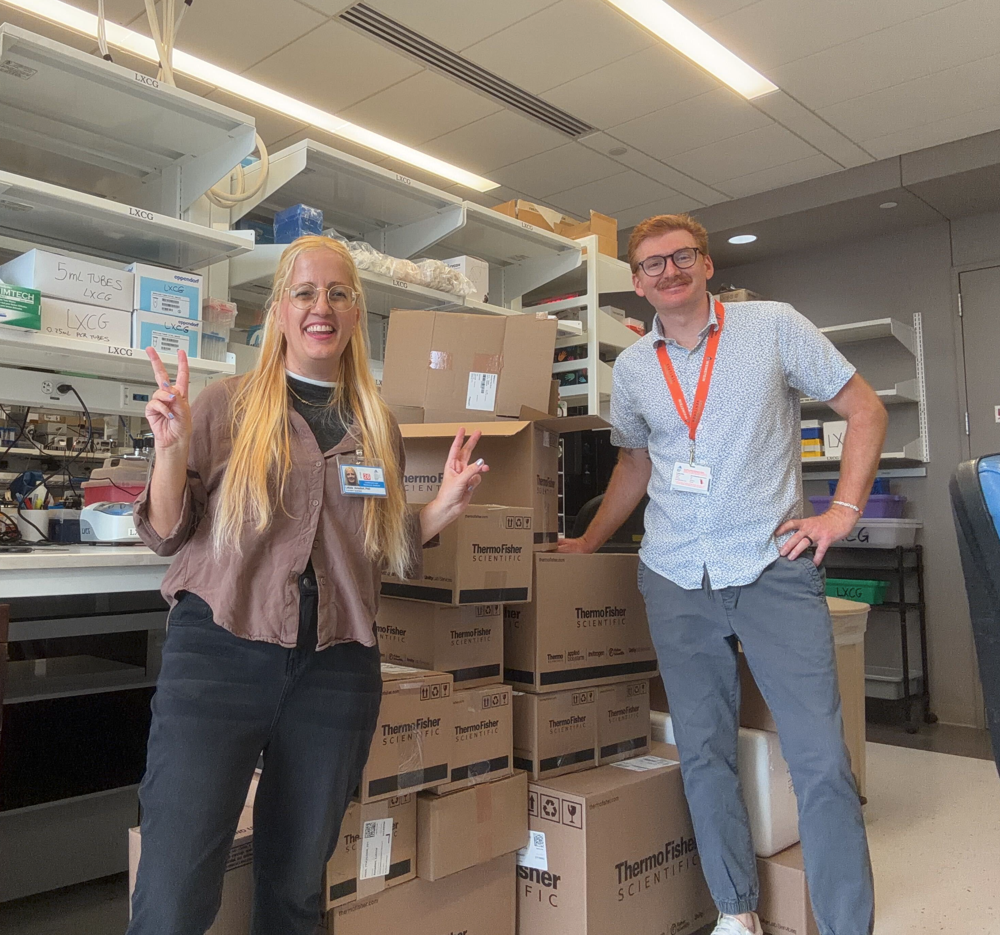
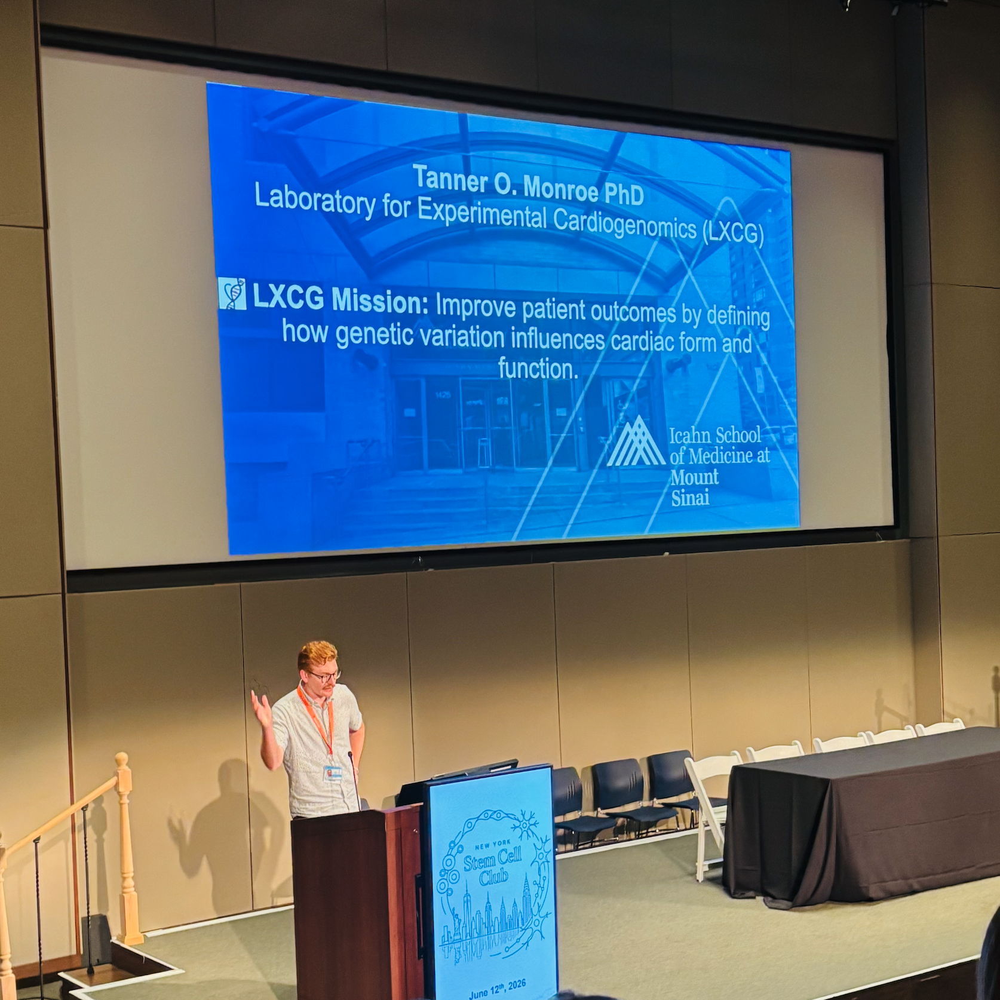

# Gallery

{: style="display: block; max-width: 400px; max-height: 400px; width: auto; height: auto; margin-left: auto; margin-right: auto;" }

*LXCG members learning all about inter-organ communication at the joint PrIISM-IGI-CVRI retreat down on Wall Street*
{: style="text-align: center;" }

{: style="display: block; max-width: 400px; max-height: 400px; width: auto; height: auto; margin-left: auto; margin-right: auto;" }

*Martin lab alumni gathering during a meeting in Houston. Big things expected from these young investigators and good friends!*
{: style="text-align: center;" }

{: style="display: block; max-width: 400px; max-height: 400px; width: auto; height: auto; margin-left: auto; margin-right: auto;" }

*Unboxing the first deliveries! Unclear if Dr. Monroe is wearing the same outfit over and over again, or if he has a closet full of them - like Superman*
{: style="text-align: center;" }

{: style="display: block; max-width: 400px; max-height: 400px; width: auto; height: auto; margin-left: auto; margin-right: auto;" }

*Dr. Monroe introducing the lab at the New York Stem Cell Club meeting.*
{: style="text-align: center;" }
